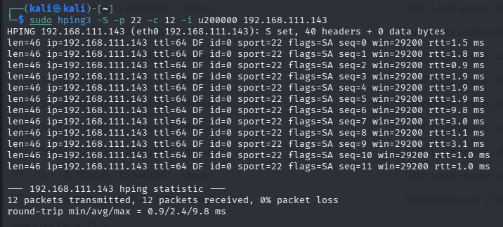
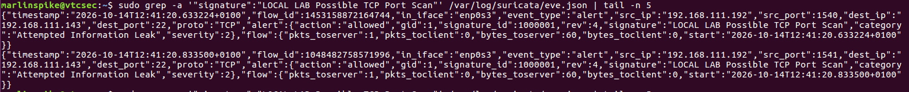
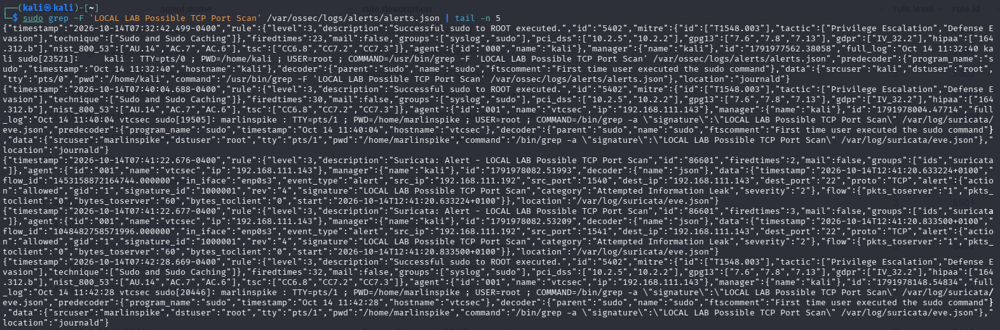
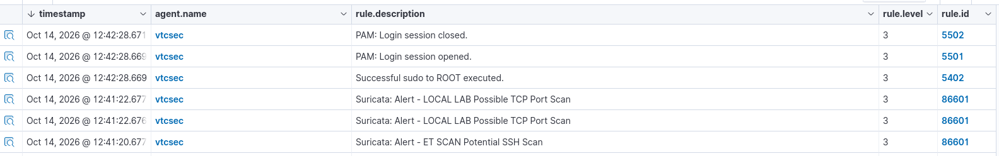

# Suricata IDS + Wazuh SIEM: TCP SYN-Probe Detection Lab

A hands-on SOC lab demonstrating network intrusion detection with Suricata and end-to-end security alert ingestion into Wazuh.

> **Result:** A controlled TCP SYN-probe test generated alerts in Suricata. Events were written to EVE JSON, collected by the Wazuh agent, processed by the Wazuh Manager, and displayed in the Wazuh dashboard.
>
> **Scope:** This project demonstrates detection and alerting. It does **not** demonstrate automatic blocking or prevention.

## Table of Contents

- [Overview](#overview)
- [Lab Architecture](#lab-architecture)
- [Tools and Technologies](#tools-and-technologies)
- [Detection Rule](#detection-rule)
- [Test Procedure](#test-procedure)
- [Results](#results)
- [Evidence](#evidence)
- [Limitations](#limitations)
- [Lessons and Next Steps](#lessons-and-next-steps)

## Overview

The objective was to build and validate a network intrusion detection pipeline using Suricata and Wazuh. Controlled traffic was generated from a Kali Linux VM toward an Ubuntu VM running Suricata. The resulting alerts were checked in Suricata's EVE JSON log and then verified in the Wazuh dashboard.

### Objectives

- Monitor the Ubuntu VM's network traffic with Suricata.
- Create and validate a custom Suricata TCP SYN detection rule.
- Generate controlled test traffic from Kali Linux.
- Confirm the alert was written to Suricata's EVE JSON log.
- Confirm Wazuh collected and processed the event.
- Capture evidence from the traffic generator, IDS log, and SIEM dashboard.

## Lab Architecture

| Component | Role | Lab address / location |
|---|---|---|
| Kali Linux | Generates controlled test traffic | `192.168.111.192` |
| Ubuntu Linux (`vtcsec`) | Suricata sensor and Wazuh agent | `192.168.111.143` |
| Suricata EVE JSON | Structured IDS event log | `/var/log/suricata/eve.json` |
| Wazuh Manager | Processes collected events | Wazuh Manager on Kali |
| Wazuh alerts JSON | Manager-side alert evidence | `/var/ossec/logs/alerts/alerts.json` |

Both IP addresses are private IPv4 addresses used within the lab network.

### Event flow

```text
Kali Linux
  |
  | Controlled TCP SYN probes
  v
Ubuntu VM running Suricata
  |
  | EVE JSON alert events
  v
Wazuh agent on Ubuntu
  |
  | Forwarded security events
  v
Wazuh Manager
  |
  v
Wazuh dashboard alerts
```

## Tools and Technologies

- **Suricata** — network intrusion detection system (IDS).
- **Wazuh** — security monitoring and SIEM platform.
- **Kali Linux** — test traffic source.
- **Ubuntu Linux** — monitored host and Suricata sensor.
- **hping3** — packet-generation utility used for the controlled TCP SYN test.
- **EVE JSON** — Suricata's structured event logging format.

## Detection Rule

The following custom rule was configured in `/etc/suricata/rules/local.rules`:

```suricata
alert tcp 192.168.111.192 any -> 192.168.111.143 any (msg:"LOCAL LAB Possible TCP Port Scan"; flags:S; flow:stateless; detection_filter: track by_src, count 10, seconds 60; classtype:attempted-recon; sid:1000001; rev:4;)
```

### Rule summary

- **Source:** `192.168.111.192` (Kali test VM)
- **Destination:** `192.168.111.143` (Ubuntu sensor)
- **Traffic match:** TCP packets with the SYN flag set
- **Threshold:** `detection_filter` configured for 10 packets within 60 seconds, tracked by source
- **Signature ID:** `1000001`
- **Revision:** `4`
- **Action:** `alert`

The rule was validated successfully with zero rule-loading failures. It is tailored to these lab IPs; adjust the addresses before reusing it in a different environment.

## Test Procedure

The following command was run on Kali Linux:

```bash
sudo hping3 -S -p 22 -c 12 -i u200000 192.168.111.143
```

This sent 12 TCP SYN probes toward port 22 on the Ubuntu VM, at an interval of approximately 200 milliseconds. The command output reported 12 packets transmitted and 12 received, with 0% packet loss.

**Interpretation:** This was a controlled, single-target TCP SYN-probe test against one port. It is best described as scan-like activity rather than a broad multi-port scan.

### Verify the Suricata event

On Ubuntu, the custom signature was searched in the EVE JSON log:

```bash
sudo grep -a '"signature":"LOCAL LAB Possible TCP Port Scan"' /var/log/suricata/eve.json | tail -n 5
```

Observed fields included:

- `event_type: alert`
- `signature: LOCAL LAB Possible TCP Port Scan`
- `signature_id: 1000001`
- `src_ip: 192.168.111.192`
- `dest_ip: 192.168.111.143`
- `dest_port: 22`
- `rev: 4`

### Verify the Wazuh alert

On the Wazuh Manager, the alert log was searched for the custom signature:

```bash
sudo grep -F 'LOCAL LAB Possible TCP Port Scan' /var/ossec/logs/alerts/alerts.json | tail -n 5
```

The matching alerts were processed by Wazuh rule `86601`, described as:

```text
Suricata: Alert - LOCAL LAB Possible TCP Port Scan
```

The Wazuh dashboard displayed the custom alert for agent `vtcsec`. It also displayed the existing Suricata signature `ET SCAN Potential SSH Scan`.

## Results

| Validation | Result |
|---|---|
| Controlled TCP SYN probes sent | 12 sent; 12 received |
| Custom Suricata rule loaded | Successful; zero rule-loading failures |
| Custom signature recorded in EVE JSON | Confirmed |
| Existing ET scan alert observed | Confirmed: `ET SCAN Potential SSH Scan` |
| Wazuh processed custom Suricata alert | Confirmed: rule `86601` |
| Alert visible in Wazuh dashboard | Confirmed for agent `vtcsec` |
| Automatic traffic blocking | Not tested or demonstrated |

### Key outcome

The lab demonstrated the event path from controlled test traffic to Suricata detection and Wazuh dashboard visibility. The test confirms that the custom detection rule fired and that Wazuh processed the resulting Suricata events. It does not establish overall detection accuracy, a measured false-positive rate, or prevention effectiveness.

## Evidence

Create an `evidence/` folder in this repository and add your screenshots using these filenames:

1. `01-Kali-Port-Scan-Test.PNG` — Kali TCP SYN test and packet summary.
2. `02-Suricata-Detection.PNG` — Suricata detection in the EVE JSON log.
3. `03-Wazuh-JSON-Alert.PNG` — Wazuh Manager JSON alert verification.
4. `04-Wazuh-Dashboard-Alerts.PNG` — Suricata alerts displayed in the Wazuh dashboard.

Once the images are committed, add these lines to display them in this README:

```markdown







```

Only include screenshots you have captured. Review them for credentials, tokens, public IP addresses, and unrelated sensitive information before publishing.

## Limitations

- The test covered one target and one destination port.
- The lab did not measure detection rates across a broad range of traffic or establish a statistically meaningful false-positive rate.
- The observed Suricata event had an `allowed` action; the test therefore demonstrates detection and alerting, not blocking.
- The Wazuh rule level is the configured alert level, not a standalone measurement of incident severity.
- The rule uses fixed lab IP addresses and should be adapted before use elsewhere.

## Lessons and Next Steps

This project provided hands-on practice with:

- Suricata local rule creation and validation.
- TCP SYN-probe testing in an authorized lab.
- EVE JSON log inspection.
- Wazuh agent log collection and manager-side alert processing.
- Correlating the same detection across IDS logs and SIEM alerts.
- Collecting reproducible evidence and documenting technical limitations.

Possible follow-up work:

1. Test additional authorized scan patterns and document which rules trigger.
2. Assess false positives using a broader set of benign test traffic.
3. Tune thresholds based on observed results.
4. Create a dedicated Wazuh dashboard view for Suricata alerts.
5. If response automation is desired, design and test it separately with explicit safeguards.

## Conclusion

The Suricata-to-Wazuh integration was successfully validated in a controlled lab. Suricata detected the TCP SYN-probe activity, logged the event in EVE JSON, and Wazuh processed and displayed the corresponding alert.

This project demonstrates practical experience with network IDS configuration, SIEM integration, alert validation, and SOC-style technical documentation.

---

**Disclaimer:** All testing described here was performed in an authorized, controlled lab environment. Do not run traffic-generation or scanning tests against systems without permission.
